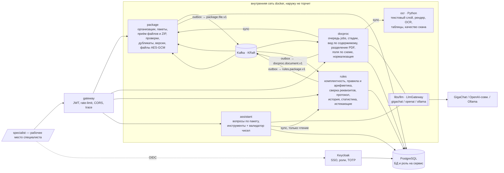
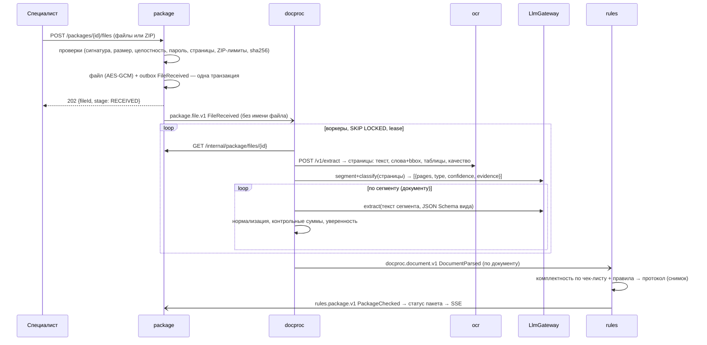
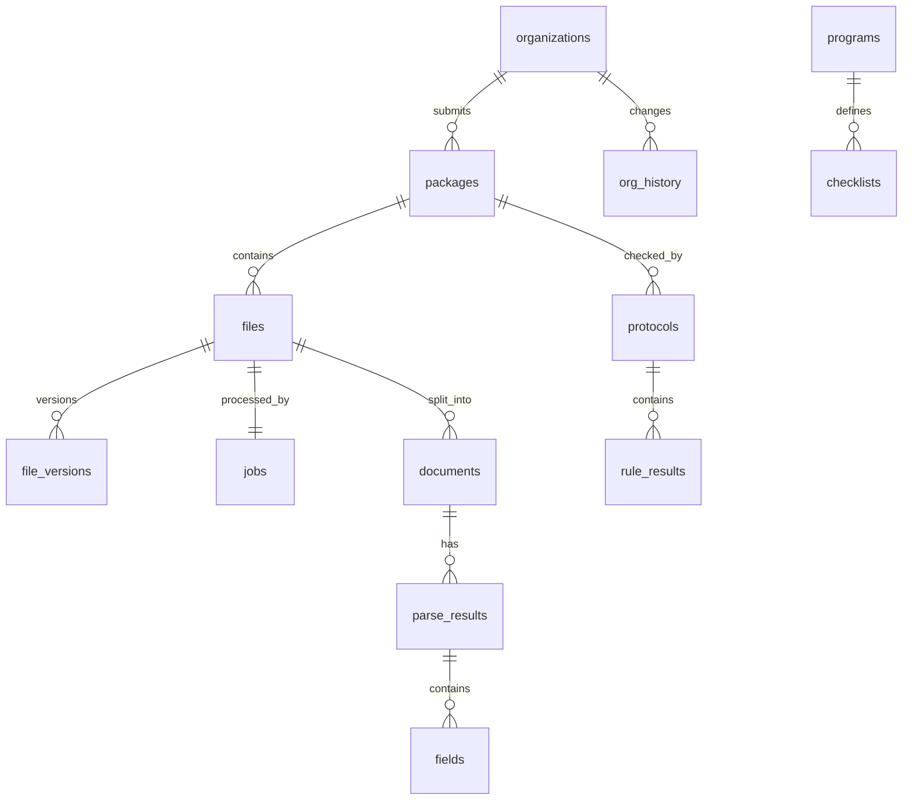

# Архитектура — «Субсидии»

Повторяет «Проходную» и конвейер «Документов»: микросервисы на Java/Spring за gateway, Python для OCR, Kafka + transactional outbox, Keycloak, PostgreSQL с БД на сервис, Jaeger, Caddy. Сердце системы — **фоновый конвейер** «текст → вид по содержимому → поля» (docproc) и **серверный движок комплектности и правил** (rules).

## Контекст

### Сервисы
| Сервис | Ответственность | БД | Публикует | Слушает | Владелец |
|---|---|---|---|---|---|
| **gateway** | вход, JWT, rate-limit, CORS, `traceparent`, маршруты `/<svc>/api/v1/**` | — | — | — | B1 |
| **package** | организации (ИНН/ОГРН), пакеты (программа, статус), приём файлов и ZIP с серверными проверками, дубликаты, версии и замена, хранение (AES-GCM), выдача оригиналов, SSE пакета | `package` | `package.package.v1`, `package.file.v1` | `docproc.document.v1`, `rules.package.v1` | B1 |
| **docproc** | очередь `jobs`, стадии, ocr, **классификация по содержимому** и разделение многодокументных файлов, извлечение полей по схеме, нормализация и контрольные суммы, уверенность, ручная смена типа → переизвлечение, журнал вызовов модели | `docproc` | `docproc.document.v1` | `package.file.v1` | B2 |
| **ocr** (Python) | PDF-слой (`pdfplumber`, включая таблицы), рендер (`pypdfium2`), предобработка, Tesseract; DOCX/XLSX — текст; метрики качества | — | — | — | B2 |
| **rules** | чек-листы и программы (данные, версии), **комплектность**, движок правил (арифметика `BigDecimal`, реквизиты, даты, сверка между документами, аномалии), правки полей специалистом, протокол (снимок), выгрузки, история по организации, статистика ошибок, истекающие документы | `rules` | `rules.package.v1` | `package.*.v1`, `docproc.document.v1` | B3 |
| **assistant** | вопросы специалиста по пакету: модель выбирает инструменты (`get_protocol`, `get_fields`, `find_anomalies`), ответ только из данных, валидатор чисел (как в «Проходной») | `assistant` | — | — | B3 |
| **libs/llm** | `LlmGateway` + адаптеры, таймауты, retry, CB, метрики | — | — | — | B3 |

### Почему так нарезано
- **Приём отделён от разбора** (Д4): package пишет файл + `FileReceived` в outbox одной транзакцией и отвечает `202`.
- **Очередь — таблица в БД docproc** (SKIP LOCKED + lease), Kafka только доставляет «файл принят». Работа видна SQL, переживает рестарт (СН «в памяти»).
- **Тип и поля (модель) отдельно от правил (код)**: docproc отвечает «что это и что в нём написано», rules — «соответствует ли пакет программе». Правила детерминированы, тестируются числами и не зависят от провайдера модели (Д11).
- **Правила — код + параметры-данные**: формула правила в Java (тест), ставки, лимиты, сроки — в `programs` (версия в протоколе). Новая программа = строка в БД.
- **assistant отдельно** и только читает: падение или ошибка модели в помощнике не влияет на протокол.

## Конвейер

### Стадии файла/документа
`RECEIVED` → `QUEUED` → `EXTRACTING_TEXT` → `CLASSIFYING` (сегментация + вид) → `EXTRACTING_FIELDS` → `VALIDATING` → **`PARSED`** | **`NEEDS_REVIEW`** (тип ниже порога / поле ниже порога / контрольная сумма) | **`UNREADABLE`**; служебные `WAITING_MODEL`, `FAILED`. Стадии пакета: `COLLECTING` → `PROCESSING` → `CHECKED` (`COMPLETE` | `INCOMPLETE` | `NEEDS_REVIEW`) → `DECIDED`.

### Очередь `jobs` и сегментация
- Как в «Документах»: `jobs(id, file_id unique, stage, attempts, next_run_at, lease_until, worker_id, last_error_code)`, захват `for update skip locked`, lease 2 мин, продление каждые 30 с, результаты стадий в `stage_outputs`, экспоненциальная пауза, `WAITING_MODEL` без траты попыток.
- **Сегментация** (FR-23): для файла > 1 страницы модель получает краткое содержание каждой страницы (первые N токенов + признаки «начало документа»: заголовок, номер, дата) и возвращает `[{fromPage, toPage, type, confidence, evidence}]`; проверка в коде: сегменты покрывают все страницы без пересечений. Каждый сегмент → `documents` (1 файл → N документов).
- Ручная смена типа (FR-29) → новая версия результата: стадия `EXTRACTING_FIELDS` с новым типом, старый результат сохраняется.

## Модель данных (минимум; таблицы — в БД своего сервиса)

- package: `organizations(id, inn unique, ogrn, name)`, `packages(id, org_id, program_code, status, created_by, created_at)`, `files(id, package_id, current_version, stage)`, `file_versions(id, file_id, version, sha256, mime, size, pages, content_enc bytea, nonce, uploaded_by, uploaded_at)`, `outbox`, `processed_events`.
- docproc: `jobs`, `stage_events`, `stage_outputs`, `documents(id, file_id, package_id, from_page, to_page)`, `parse_results(id, document_id, type, type_confidence, evidence, source[MODEL|SPECIALIST], model, prompt_version, schema_version)`, `fields(result_id, name, value, raw, page, bbox, confidence, checks)`, `doc_types(code, name, schema, version)`, `llm_calls`, `outbox`, `processed_events`.
- rules: `programs(code, name, params jsonb, version, valid_from)`, `checklists(program_code, version, items jsonb)`, `package_view` (проекция документов и полей), `field_overrides(document_id, field, value, by, at)`, `protocols(id, package_id, version, checklist_version, rules_version, status, snapshot jsonb, created_by, created_at)` (неизменяемые), `rule_results(protocol_id, rule_code, status, message, evidence jsonb, amount_expected?, amount_actual?)`, `org_history` (append-only), `expiring_documents` (view), `outbox`, `processed_events`.
- assistant: `conversations`, `messages(role, content, tool_calls jsonb, validator_status)`.
- Деньги — `numeric(19,2)`, даты — `date`, время — `timestamptz`.

## События (Kafka)
| Топик | Типы | Producer | Payload |
|---|---|---|---|
| `package.package.v1` | `PackageCreated`, `PackageSubmitted`, `PackageDecided` | package | packageId, orgId, inn, programCode |
| `package.file.v1` | `FileReceived`, `FileReplaced`, `FileRemoved` | package | fileId, packageId, version, mime, pages (**без имени файла**) |
| `docproc.document.v1` | `StageChanged`, `DocumentsSegmented`, `DocumentParsed`, `DocumentUnreadable`, `DocumentFailed`, `TypeOverridden` | docproc | fileId, documentId, stage, type, typeConfidence, fields[], reasonCode |
| `rules.package.v1` | `PackageChecked`, `FieldCorrected` | rules | packageId, protocolId, version, protocolStatus, completeness (%), failed, warnings, needsReview |

## Безопасность (кратко, подробно — SECURITY.md)
- Специалисты — Keycloak SSO (PKCE), роли `SPECIALIST`, `SENIOR_SPECIALIST` (TOTP, решения, программы), `AUDITOR` (только чтение протоколов и статистики).
- Файлы — AES-256-GCM в БД, выдача только через `package` с проверкой роли и аудитом; `/internal/package/files/{id}` — только `svc-docproc`.
- Каждый вердикт и сумма считаются в `rules`; фронт не присылает «результаты» — только правки полей (как ввод данных), сервер пересчитывает.

## Наблюдаемость
OpenTelemetry → Jaeger: файл — один трейс package → Kafka → docproc → ocr → модель → rules. Метрики: `package_upload_seconds`, `package_rejects_total{code}`, `docproc_jobs{stage}`, `docproc_stage_seconds{stage}`, `docproc_type_confidence` (гистограмма), `llm_request_seconds{provider,model,outcome}`, `rules_eval_seconds`, `rules_results_total{rule,status}`. JSON-логи с `traceId`, без реквизитов и текстов.
