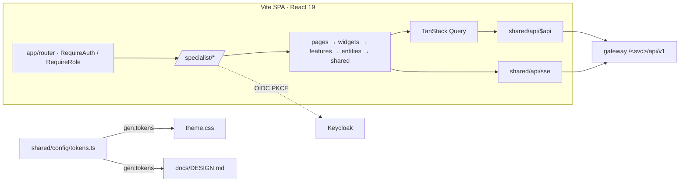

# ARCHITECTURE — frontend

Общая архитектура — `../../docs/ARCHITECTURE.md`. Правила FSD — скилл `frontend-fsd`. Здесь — устройство приложения (повторяет «Проходную», ADR-013).

## Схема


## Потоки
**Пакет (F1).** `create-package` (`POST /package/api/v1/packages`) → `PackagePage`. `upload-files`: `react-dropzone` → `POST …/files` (multipart, несколько файлов/ZIP) → `202` сразу рисуем строки `RECEIVED`, `rejected[]` — у файла с подсказкой. SSE `/package/api/v1/packages/{id}/stream` → `invalidateQueries(['package', id])`. Документы файла (сегменты) — дочерние строки `FileList`. Клик → `DocumentViewer` (страницы из `/files/{id}/content` как blob, pdf.js; изображения — canvas; bbox-слой) + `FieldsPanel` (`/docproc/api/v1/documents/{id}/result`). `change-type` → `PUT /docproc/…/documents/{id}/type`; `correct-field` → `PUT /rules/…/packages/{id}/fields`; `replace-file` → `POST …/files/{fileId}/versions`. После мутации — ждём SSE `package.checked`, протокол перечитывается.

**Протокол (F2).** `ProtocolPanel` читает `GET /rules/api/v1/packages/{id}/protocol` и **только показывает**: группы FAILED / WARNING / DATA_MISSING / PASSED, у правила — `message`, `expected`/`actual` (строки денег форматируются, но не пересчитываются), `evidence` → клик открывает документ и поле в `DocumentViewer`. `export-protocol` — скачивание файла. Версии — `GET …/protocols`.

**Аналитика (F2).** `OrganizationPage` (история), `StatsPage` (recharts по `/rules/api/v1/stats/errors` + «как посчитано»), `ExpiringPage`, `AssistantChat` (ответ + источники + статус валидатора).

## Стек
React 19, TS strict, Vite, npm · Tailwind 4 + shadcn/ui · motion · TanStack Query · axios · zustand · react-hook-form + zod · i18next · React Router · `oidc-client-ts` · `react-dropzone` · `pdfjs-dist` · `react-zoom-pan-pinch` · recharts · lucide-react · MSW (только dev).

## Структура папок
```
frontend/
  src/
    app/        providers/(router, query, auth, theme, motion), styles/theme.css (генерируется)
    pages/      PackagesQueuePage, PackagePage (F1), OrganizationPage, StatsPage, ExpiringPage, ProgramsPage (F2), NotFound, Forbidden
    widgets/    FileList, DocumentViewer, FieldsPanel, UploadDropzone (F1) · AppSidebar, PackagesTable, ProtocolPanel, CompletenessCard, HistoryTimeline, ErrorStatsChart, AssistantChat, ModelStatusBadge (F2)
    features/   create-package, upload-files, replace-file, remove-file, change-type, correct-field (F1) · export-protocol, decide-package, ask-assistant, reprocess-file (F2)
    entities/   Session, Organization, Package, PackageFile, Document (stageView, typeView), ParsedField, Protocol (ruleStatusView), RuleResult, Program
    shared/     api/ ($api, schema.ts, sse.ts, problem.ts) · config/ (tokens.ts, motion.ts) · lib/ (money.ts — только форматирование строк, cn) · hooks/ · ui/
    mocks/      MSW, только dev
```

## Ключевые решения
ADR-005 (тип не из имени), ADR-006/009 (правила и правки — на сервере), ADR-007 (деньги строками — `shared/lib/money.ts` только форматирует), ADR-012 (SSE), ADR-013 (дизайн-система как в «Проходной»).
