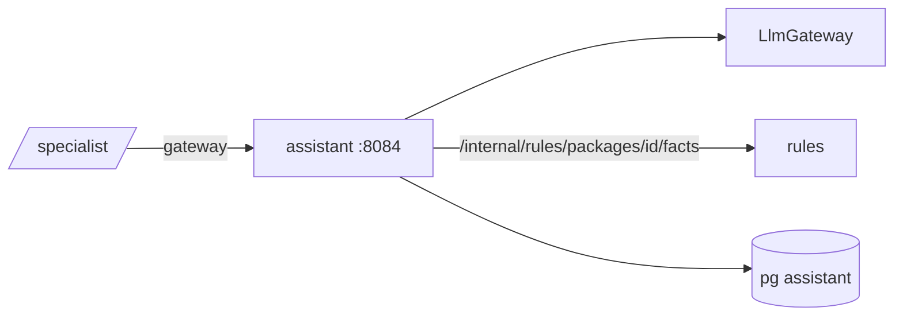

# ARCHITECTURE — assistant

Система целиком — `../../../docs/ARCHITECTURE.md`, контракт — `../../../docs/API.md`, раскладка Java-сервиса — скилл `backend-spring`.
## Схема


## Поток
1. Проверка роли и доступа к пакету (через rules facts — 404 для чужого).
2. `chat(messages, tools)` → вызовы инструментов → результаты в контекст → финальный ответ.
3. `NumberValidator`: все числа ответа ∈ числам из результатов инструментов (нормализация форматов) → статус.
4. Сохранение `messages` с `tool_calls` и статусом.

## Стек
Spring Boot 3.5, jOOQ, Liquibase, `libs/llm`.

## Структура папок
```
assistant/
  src/main/java/ru/subsidy/assistant/
    api/ AskApi   tools/ ProtocolTool, FieldsTool, AnomaliesTool, MissingTool   validate/ NumberValidator   rules/ RulesClient
  src/test/java/…/   # NumberValidatorTest, ToolsAccessTest
```

## Данные
`conversations`, `messages`.

## События
Нет.

## Зависимости
rules (internal facts), `LlmGateway`.

## Конфигурация
`ASSISTANT_ENABLED`, `RULES_URL`, `LLM_*`.
