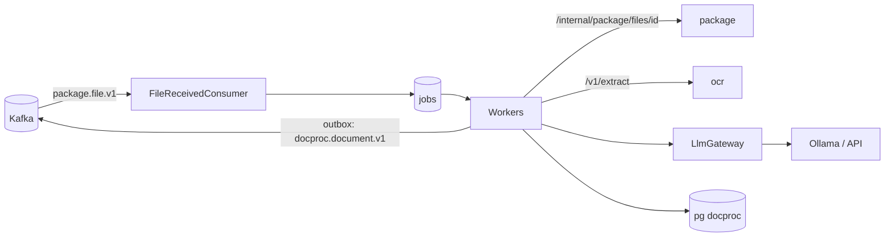

# ARCHITECTURE — docproc

Система целиком — `../../../docs/ARCHITECTURE.md`, контракт — `../../../docs/API.md`, раскладка Java-сервиса — скилл `backend-spring`.
## Схема


## Поток задания
1. Консьюмер: `insert into jobs … on conflict do nothing` → QUEUED; `FileReplaced` → сброс на EXTRACTING_TEXT.
2. EXTRACTING_TEXT: файл → ocr (PDF/изображения) или POI (DOCX/XLSX) → страницы с текстом, словами, таблицами, качеством.
3. CLASSIFYING: 1 страница → `classify`; > 1 → `segment` → сегменты, проверка покрытия страниц → `documents`.
4. EXTRACTING_FIELDS: по каждому документу `extract` по схеме вида (+ изображение при слабом OCR).
5. VALIDATING: `MoneyNormalizer`, `DateNormalizer`, `RequisitesChecks` → `checks[]`; `ConfidenceScorer`.
6. `parse_results` + `fields` + outbox `DocumentParsed` (по документу) — одна транзакция.

## Стек
Spring Boot 3.5, jOOQ, Liquibase, Spring Kafka, `libs/llm`, networknt json-schema-validator, Apache POI (DOCX/XLSX текст), Resilience4j.

## Структура папок
```
docproc/
  src/main/java/ru/subsidy/docproc/
    api/        DocumentsApi (result, type override, reprocess), ModelApi, InternalApi
    queue/      JobClaimer, LeaseKeeper, WorkerPool, Backoff
    pipeline/   StageMachine, stages/
    text/       OcrClient, OfficeTextExtractor (POI)
    classify/   Segmenter, Classifier, TypeRegistry
    extract/    FieldExtractor, SchemaValidator
    normalize/  MoneyNormalizer, DateNormalizer, RequisitesChecks (ИНН, ОГРН, КПП, БИК+счёт), ConfidenceScorer
  src/main/resources/prompts/   # segment.v1.md, classify.v1.md, extract.v1.md
  src/test/java/…/              # RestartMidStageTest, ConcurrentClaimTest, RenamedFilesSameTypeTest, SegmenterCoverageTest, MoneyNormalizerTest
```

## Данные
`jobs`, `stage_events`, `stage_outputs`, `documents`, `parse_results`, `fields`, `doc_types`, `llm_calls`, `outbox`, `processed_events`.

## События
Слушает `package.file.v1`. Публикует `docproc.document.v1`.

## Зависимости
package, ocr, `LlmGateway` — с таймаутом и CB.

## Конфигурация
`DOCPROC_WORKERS`, `JOB_LEASE`, `JOB_MAX_ATTEMPTS`, `OCR_URL`, `PACKAGE_URL`, `CLASSIFY_MIN_CONFIDENCE`, `FIELD_REVIEW_THRESHOLD`, `VISION_FALLBACK_ENABLED`, `LLM_*`.

## Метрики (DP-16, `/actuator/prometheus`)
| Метрика | Теги | Зачем |
|---|---|---|
| `docproc_stage_duration_seconds` (гистограмма) | `stage`=text\|segment\|fields, `outcome`=ok\|error | p50/p95 стадий (EVAL «Время»), где узкое место |
| `docproc_type_confidence` (SLO 0.5/0.7/0.8/0.9/0.95) | `type` | распределение уверенности модели по видам — для порогов `CLASSIFY_MIN_CONFIDENCE` и калибровки (DP-15) |
| `docproc_documents_total` | `type`, `source`=MODEL\|SPECIALIST, `reason` | доля документов на ручную проверку и правок специалиста |
| `docproc_files_finished_total` | `stage` | PARSED / NEEDS_REVIEW / UNREADABLE / FAILED |
| `docproc_retries_total` | `code` | MODEL_UNAVAILABLE, MODEL_INVALID_OUTPUT, PIPELINE_ERROR |

Теги только из закрытых словарей: без id и данных организаций. Вызовы модели дополнительно меряет `libs/llm` (`DefaultLlmGateway`).
