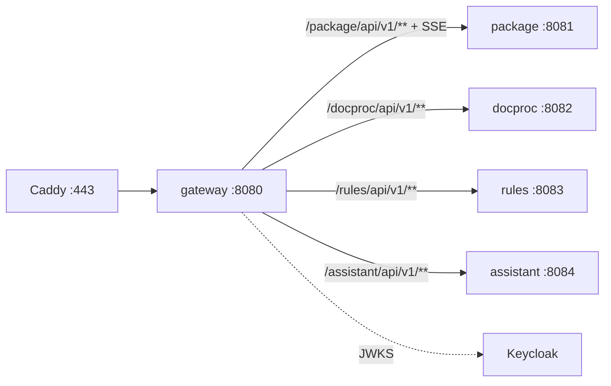

# ARCHITECTURE — gateway

Система целиком — `../../../docs/ARCHITECTURE.md`, контракт — `../../../docs/API.md`, раскладка Java-сервиса — скилл `backend-spring`.
## Схема


## Поток
1. Caddy терминирует TLS → gateway.
2. `/internal/**` → 404; CORS; лимит тела; rate-limit.
3. JWT (issuer → JWKS); роли не проверяем — это делает сервис.
4. `traceparent`, `X-Request-Id`, переписывание пути, проксирование.
5. Ошибки gateway — problem+json (`UNAUTHORIZED`, `RATE_LIMITED`, `PAYLOAD_TOO_LARGE`, `UPSTREAM_UNAVAILABLE`).

## Стек
Spring Boot 3.5 WebFlux, Spring Cloud Gateway 2025.0, oauth2-resource-server, Micrometer Tracing + OTel, Bucket4j/Resilience4j.

## Структура папок
```
gateway/
  build.gradle.kts                  # plugin subsidy.gateway
  src/main/java/ru/subsidy/gateway/
    config/    RoutesConfig, SecurityConfig, CorsConfig
    filter/    InternalPathBlockFilter, RateLimitFilter, RequestIdFilter, BodyLimitFilter
    exception/ GatewayErrorHandler
  src/test/java/ru/subsidy/gateway/  # RoutesIntegrationTest, InternalBlockedTest, NoTokenTest
```

## Данные
Своей БД нет; счётчики rate-limit в памяти (не данные).

## События
Нет.

## Зависимости
Keycloak (JWKS). Upstream: package, docproc, rules, assistant.

## Конфигурация
`OIDC_ISSUER_URI`, `PACKAGE_URL`, `DOCPROC_URL`, `RULES_URL`, `ASSISTANT_URL`, `CORS_ORIGINS`, `UPLOAD_MAX_MB`.
