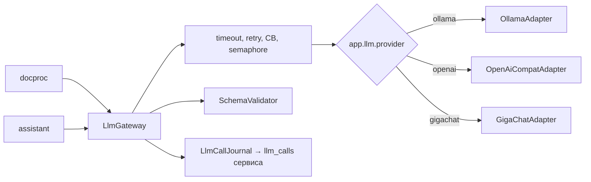

# ARCHITECTURE — libs/llm

Система целиком — `../../../../docs/ARCHITECTURE.md`, контракт — `../../../../docs/API.md`, раскладка Java-сервиса — скилл `backend-spring`.
## Схема


## Стек
Java 21, Spring Boot autoconfigure, `RestClient`, Jackson, networknt json-schema-validator, Resilience4j, Micrometer.

## Структура папок
```
libs/llm/
  build.gradle.kts                     # plugin subsidy.library
  src/main/java/ru/subsidy/llm/
    LlmGateway.java ChatMessage.java Tool.java ChatResult.java LlmStatus.java LlmException.java LlmCallJournal.java
    core/  ResilientLlmGateway, SchemaValidator, Prompts
    infra/ollama/ infra/openai/ infra/gigachat/
    config/ LlmAutoConfiguration, LlmProperties
  src/test/java/ru/subsidy/llm/        # WireMock-тесты адаптеров, LlmIsolationTest
```

## Данные
Нет; журнал пишет сервис через `LlmCallJournal`.

## События
Нет.

## Зависимости
Ollama (профиль `llm-local`) или API провайдера; ключи только из env.

## Конфигурация
`LLM_PROVIDER`, `LLM_BASE_URL`, `LLM_MODEL`, `LLM_VISION_MODEL`, `LLM_API_KEY`, `LLM_TIMEOUT_SECONDS`, `LLM_MAX_CONCURRENCY`, `GIGACHAT_AUTH_KEY`, `GIGACHAT_SCOPE` (`../../../docs/LLM.md`).
