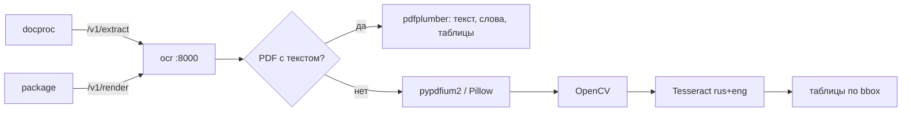

# ARCHITECTURE — ocr

Система целиком — `../../../docs/ARCHITECTURE.md`, контракт — `../../../docs/API.md`, раскладка Python-сервиса — скилл `backend-spring` (раздел Python).
## Схема


## Поток
1. JWT `aud=ocr`, лимит размера; формат по байтам.
2. Страницы (≤ `UPLOAD_MAX_PAGES`): текстовый слой или рендер 300 dpi → предобработка → Tesseract.
3. Таблицы, метрики качества; ответ JSON, ничего не сохраняется.

## Стек
FastAPI, uvicorn, pydantic 2, pdfplumber, pypdfium2, Pillow, pillow_heif, opencv-python-headless, pytesseract + Tesseract 5, python-magic, PyJWT.

## Структура папок
```
ocr/
  pyproject.toml uv.lock Dockerfile     # apt: tesseract-ocr tesseract-ocr-rus
  src/ocr/
    main.py api/ (extract, render, health) auth.py
    pdf.py render.py preprocess.py tesseract.py tables.py quality.py config.py
  tests/ test_pdf_text.py test_tables.py test_quality.py test_rotate.py
```

## Данные
Нет.

## События
Нет.

## Зависимости
Keycloak (JWKS).

## Конфигурация
`OCR_LANGS`, `OCR_DPI`, `OCR_MAX_PAGES`, `OIDC_ISSUER_URI`, пороги метрик.
