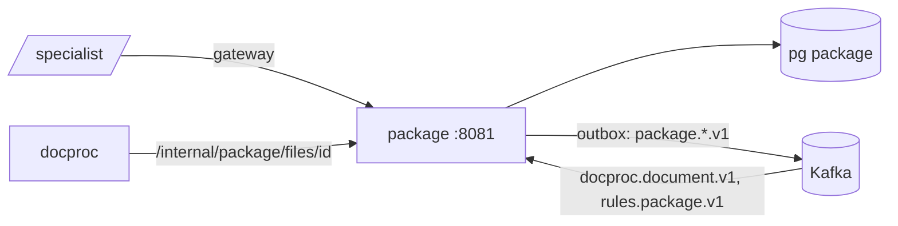

# ARCHITECTURE — package

Система целиком — `../../../docs/ARCHITECTURE.md`, контракт — `../../../docs/API.md`, раскладка Java-сервиса — скилл `backend-spring`.
## Схема


## Поток приёма
1. `POST /packages/{id}/files` (multipart, несколько файлов или ZIP) — роль `SPECIALIST`, пакет не решён.
2. ZIP → `ZipExpander` (лимиты, пути) → поток записей; каждая запись и каждый файл → `FileInspector` (цепочка `*Check`).
3. Одна транзакция на файл: `file_versions` (AES-GCM) + `files(stage=RECEIVED)` + outbox `FileReceived` (**без имени и пути**).
4. `202 {files[], rejected[]}`; дальше стадии из `docproc.document.v1` → `files.stage` → SSE; `rules.package.v1` → статус пакета.

## Стек
Spring Boot 3.5, jOOQ, Liquibase, Spring Kafka, Apache Tika core, PDFBox, TwelveMonkeys ImageIO, Apache POI (проверка DOCX/XLSX), Commons Compress.

## Структура папок
```
package/
  build.gradle.kts
  src/main/java/ru/subsidy/package_/          # `package` — ключевое слово Java
    api/          OrganizationsApi, PackagesApi, FilesApi, InternalFilesApi, dto/
    organization/ OrganizationService, InnValidator
    pkg/          PackageService, DecisionService
    upload/       UploadService, ZipExpander, FileInspector, checks/*Check
    storage/      FileCrypto (AES-GCM), FileRepository
    events/       DocprocConsumer, RulesConsumer
    sse/          PackageStreamService
  src/main/resources/db/changelog/
  src/test/java/…/upload/                     # по тесту на каждую проверку, zip-бомба, path traversal
```

## Данные
`organizations`, `packages`, `files`, `file_versions(content_enc, nonce, sha256, mime, size, pages, original_name — только для показа)`, `page_previews`, `outbox`, `processed_events`.

## События
Публикует `package.package.v1`, `package.file.v1`. Слушает `docproc.document.v1`, `rules.package.v1`.

## Зависимости
Keycloak; ocr (`/v1/render` для превью, асинхронно).

## Конфигурация
`UPLOAD_MAX_MB`, `UPLOAD_MAX_PAGES`, `UPLOAD_MAX_FILES`, `ZIP_MAX_UNPACKED_MB`, `ZIP_MAX_ENTRIES`, `IMAGE_MIN_PX`, `FILES_ENCRYPTION_KEY`.
