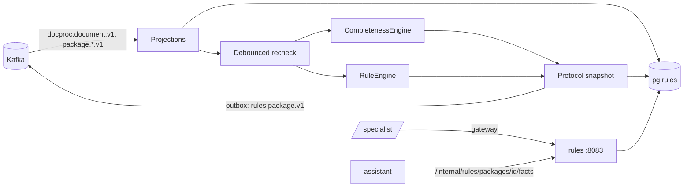

# ARCHITECTURE — rules

Система целиком — `../../../docs/ARCHITECTURE.md`, контракт — `../../../docs/API.md`, раскладка Java-сервиса — скилл `backend-spring`.
## Схема


## Поток перепроверки
1. Событие `DocumentParsed`/`TypeOverridden`/`FileRemoved` или правка поля → отметка пакета «грязный».
2. Через 2 с без новых событий (debounce, таблица `recheck_requests` — не память) — сборка `PackageFacts`: документы, тип, поля = правка ?? модель.
3. `CompletenessEngine` по чек-листу версии программы → пункты и `missing[]`.
4. `RuleEngine`: каждое `Rule` → `RuleResult(status, message, evidence, expected, actual)`.
5. Протокол (новая версия, снимок фактов и версий) + `rule_results` + outbox `PackageChecked` — одна транзакция.

## Стек
Spring Boot 3.5, jOOQ, Liquibase, Spring Kafka, Apache POI, PDFBox, Micrometer.

## Структура папок
```
rules/
  src/main/java/ru/subsidy/rules/
    api/          ProtocolApi, FieldsApi, ExportApi, HistoryApi, StatsApi, ExpiringApi, ProgramsApi, InternalFactsApi
    facts/        PackageFacts, FactsAssembler, FieldOverrideService
    money/        Money
    completeness/ CompletenessEngine, ChecklistItem, Condition
    engine/       RuleEngine, Rule, RuleResult, rules/ (InnChecksumRule, CrossInnRule, SumInvoiceItemsRule, SubsidyCapRule, …)
    protocol/     ProtocolService, ProtocolExporter (DOCX/XLSX/PDF)
    history/      OrgHistoryService (append-only)
    stats/        ErrorStatsService, ExpiringService
    events/       DocprocConsumer, PackageConsumer
  src/main/resources/db/changelog/  # programs, checklists, package_view, field_overrides, protocols, rule_results, org_history(+trigger), recheck_requests
  src/test/java/…/engine/rules/     # тест с числами на каждое правило
```

## Данные
`programs`, `checklists`, `package_view`, `field_overrides`, `recheck_requests`, `protocols` (неизменяемые), `rule_results`, `org_history`, `outbox`, `processed_events`.

## События
Слушает `docproc.document.v1`, `package.package.v1`, `package.file.v1`. Публикует `rules.package.v1`.

## Зависимости
docproc (`/internal/docproc/packages/{id}/documents` — при пересборке проекции).

## Конфигурация
`DEFAULT_PROGRAM`, `EXPIRING_DAYS`, `DOCPROC_URL`.
